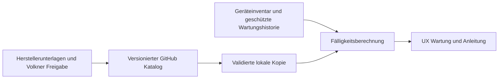

# Wartung und Service in Volkner UX

Stand 9. November 2026. Entwicklungsstand, noch keine vollständig freigegebene Wartungsplanung.

## Ziel

Fahrzeugbezogene Wartung für Heizung, Aufbau und sämtliche eingebauten Systeme in UX anzeigen. Der versionierte JSON-Katalog wird nach dem Prinzip der Fahrzeug-Bedienungsanleitung auf GitHub gepflegt. Der Wartungskatalog wird im eigenen Repository `realmxv/vehicle-maintenance` gepflegt, unabhängig von `realmxv/vehicle-manual`. Katalog und Bedienungsanleitung haben getrennte Versionen.

## Bedienung und Daten

Die erste UX-Ansicht zeigt alle acht Bereiche, filterbare Aufgaben und Quellen. Webasto-TTP50-Bausteine bilden den Start. Für weitere Geräte werden keine Intervalle erfunden. Ohne bestätigte Gerätezuordnung zeigt die Ansicht einen Katalog, keinen fahrzeugbezogenen Freigabestatus. Ein Datum lässt sich ausdrücklich als unverbindliche Fälligkeitsvorschau berechnen; es erzeugt keinen Wartungsnachweis.

Zielausbau: Inbetriebnahme und letzte Wartung je Geräteinstanz, Kilometer/Betriebsstunden mit Herkunft und Aktualität, Kalender- und Ereignisauslöser. Je nach Vorgabe löst die zuerst erreichte Grenze aus. Unbekannte oder veraltete Zähler ergeben keine grüne Freigabe. Vier Wochen sind 28 Tage; Monate werden als Kalendermonate mit Begrenzung auf den letzten gültigen Monatstag berechnet.

## Freigabe und Herkunft

Jede Regel braucht Hersteller/Typ, Varianten-/Baujahrzuordnung, Tätigkeit, Auslöser, Quellenrevision und Seite, Verantwortlichkeit und Freigabestatus. Herstellervorgabe, Herstellerempfehlung und eigene Volkner-Serviceempfehlung getrennt führen. Keine pauschale Jahresfrist für Aufbau, Heizung oder alle anderen Systeme ohne fachliche Grundlage. Die drei Startbausteine ersetzen nicht den vollständigen Wartungsumfang der Herstellerunterlagen.

## GitHub und Fahrzeugdaten

Das eigene Wartungsrepository enthält allgemeine Regeln und Software. Kundennamen, Fahrzeugnummern, Seriennummern und Wartungsnachweise gehören in den geschützten Fahrzeugdatensatz. Originalunterlagen nicht ohne geklärte Veröffentlichungsrechte hochladen. Updates müssen validiert und atomar übernommen werden, mit letzter gültiger Offline-Version, sichtbarem Quellenstand und Rückfall bei Fehlern. Der erste Stand enthält eine gebündelte Offline-Katalogkopie; automatisches Remote-Update ist noch nicht implementiert.

## Nächste Umsetzung und Abnahme

- Geräteinventar je Fahrzeug und Freigaben pflegen; drei gleiche Heizgeräte getrennt behandeln.
- Weitere belegte Herstellerintervalle und Volkner-Aufbauprüfungen ergänzen.
- Dauerhafte, berechtigte Wartungshistorie mit Datum, Prüfer, Befund und tatsächlich erledigten Prüfpunkten; Quittieren einer Meldung darf keine Wartung vortäuschen.
- Startseitenhinweise für bald fällig, fällig, überfällig und Klärungsbedarf ergänzen, sobald echte Fahrzeugdaten vorliegen.
- Offline-Updates, Rücknahme fehlerhafter Kataloge, Zählerausfall und doppelte Synchronisation prüfen.

Das Diagramm zeigt den Zielzustand. Der erste Stand ist eine lokale Katalogansicht mit Fälligkeitsvorschau, ohne Fahrzeug- oder Backend-Anbindung.

## Vorschau und Prüfung

Im Repository mit `python -m http.server 8080` einen lokalen Server starten und `http://localhost:8080/preview.html` öffnen. Die Vorschau lädt nur den lokalen Katalog. Rechentests: `node test.cjs`. Für den UX-Offline-Build `catalog.json` in eine lokale JavaScript-Zuweisung `window.VolknerMaintenanceCatalog = ...` umwandeln und vor `maintenance.js` einbinden.

## Anleitung, Datum, Bilder und Wartungsintervall pflegen

`catalog.json` ist die zentrale Datenquelle; `schema.json` prüft die Felder. `entry-template.json` als Vorlage verwenden und den ausgefüllten Eintrag in `items` übernehmen. Neue Inhalte lassen sich direkt über GitHub bearbeiten; eine eigene Eingabemaske in UX ist noch nicht enthalten.

| Feld | Inhalt |
| --- | --- |
| title, equipment, category | Wartungsaufgabe, konkretes Gerät und Bereich |
| instructions | Beschreibung, geordnete Arbeitsschritte und Warnhinweise |
| updatedAt | Änderungsdatum des Eintrags, YYYY-MM-DD |
| documents | Anleitung/PDF, Dokumentnummer, Ausgabemonat YYYY-MM, Seite und Link |
| images | Bilddatei/HTTPS-Link, Bildunterschrift, Alternativtext und optional Aufnahmedatum |
| interval | Genau eine Frist: days, months, operatingHours, distanceKm oder event |
| source, status | Beleg und Quellenprüfstand; pending bedeutet ungeklärt, interval muss dann null sein |

Beispiele für `interval`: `{"days":28}`, `{"months":12}`, `{"operatingHours":500}`, `{"distanceKm":10000}`, `{"event":"Nach Instandsetzung"}`. Diese Beispiele sind Datenformate, keine allgemeinen Wartungsempfehlungen. Die UX berechnet bisher nur Tage und Kalendermonate; Stunden, Kilometer und Ereignisse werden angezeigt, benötigen aber echte Zähler bzw. erfasste Ereignisse für die Fälligkeit. Kombinierte Fristen werden in dieser Version nicht akzeptiert, damit keine Teilfrist übersehen wird.

Bilder unter `assets/images/`, Anleitungen unter `assets/documents/` ablegen, anschließend den relativen Pfad im Eintrag speichern. Externe Links müssen HTTPS verwenden. Bei nicht veröffentlichbaren Herstellerunterlagen können Dokumentnummer, Ausgabe und Seite mit `url: null` hinterlegt werden. Die vorhandenen Webasto-PDFs werden nicht öffentlich hochgeladen.

„Zuletzt gewartet“, Prüfer, Befund und Fahrzeug-/Gerätekennung sind Wartungsnachweise und gehören nicht in diesen allgemeinen Katalog. `updatedAt` ist kein Wartungsdatum. Das Repository und die Vorschau sind öffentlich; nur freigegebene allgemeine Inhalte einstellen.

## Rücksetzberechtigungen

Version 0.3.0 ergänzt `type`, `equipmentId` und `reset`. Webasto 28-Tage-Information: ausschließlich Steuerung nach bestätigtem Normalbetrieb. Fachmännische Wartung alle 7 Jahre: ausschließlich Volkner-Service online mit Nachweis. Details und Implementierungsgrenzen: [Rücksetzregeln](reset-policy.md).

## Verbindliche Volkner-Vorgaben vom 09.11.2026

- Abgasanlage einschließlich Schalldämpfer alle 24 Monate prüfen; Austausch nach Zustand.
- Heizgerät und komplette Abgasanlage einschließlich Schalldämpfer spätestens nach 180 Monaten ersetzen.
- Kühlmittel-Umwälzpumpe und Kraftstoff-Dosierpumpe jeweils spätestens nach 84 Monaten ersetzen.

Diese Fristen sind Volkner-Vorgaben, keine behaupteten Webasto-Hersteller-Austauschfristen. Alle vier Punkte dürfen nur durch Volkner-Service online mit Nachweis bestätigt werden. Austauschpunkte benötigen zusätzlich einen Austauschnachweis. Erste Frist ab Einbau/Inbetriebnahme, danach ab tatsächlicher Durchführung der jeweiligen Tätigkeit. Eine Prüfung setzt keine Austauschfrist zurück; Pumpentausch setzt keine Frist der übrigen Bauteile zurück. Ein Komplettwechsel darf Pumpenfristen nur dann neu starten, wenn auch die betreffenden Pumpen tatsächlich mit ersetzt und dokumentiert wurden. Fehlendes Einbaudatum bedeutet Klärungsbedarf, niemals Start der Frist am heutigen Tag. Die Abgasprüfung ersetzt keine noch offene Freigabe der zusätzlichen Aluminium-Abgasleitung. Defekte können einen früheren Austausch erfordern.

Version 0.4.1: Separater Saisonpunkt auf Nutzerwunsch aus dem Volkner-Katalog entfernt. Quellenunterlagen bleiben unverändert; der Katalog ersetzt nicht sämtliche Herstellerhinweise.

Version 0.4.2: Fachmännische Wartung fällig – Fehlerspeicher, elektrische Anschlüsse und Leitungen, Kraftstoffleitung, Schläuche sowie Heizungsfunktion prüfen. Alle 7 Jahre als abweichende Volkner-Vorgabe; Webasto nennt hierfür mindestens alle 2 Jahre. Abgasprüfung weiterhin alle 2 Jahre.
